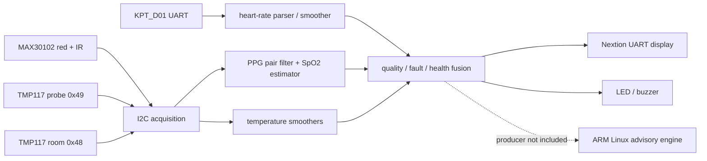

# 2026 AMD FPGA 自主选题设计报告

## 1. 选题与目标

作品面向学生航天舱健康监测演示：一块 PYNQ-Z2 并行接收心率、血氧、探头温度和室温，输出 Normal、Warning、Danger、SystemError 四态，并显示数值、趋势与故障原因。重点是传感器接入、PL 中的滤波和容错、可解释的有效性标志以及可复现的工程。该系统不承担临床诊断或生命保障功能，阈值是可配置的演示参数。

设计要处理的实际工程问题是：单个毛刺不应直接触发故障；通信超时或质量失效后不能继续使用陈旧数值；多器件故障需要和生理异常分开解释。与只显示四个数字的方案相比，本项目保留每路可用性、故障原因和系统级降级状态。

## 2. 功能结构与数据流

The top is `src/rtl/wyx_final_board_top.sv`. It instantiates the shared I2C acquisition, PPG filtering and SpO2 estimator, existing four-channel filter/fault/fusion modules, Nextion driver, and PS7 clock wrapper. The PS7 Block Design supplies FCLK0 at 25 MHz. The ARM Python monitor is an independent advisory consumer of JSONL records, not a verified direct reader of PL registers; a live PL-to-ARM producer is still needed.

### Fixed-point and interface contract

| Channel | Physical source | Interface | Internal numerical form |
| --- | --- | --- | --- |
| Heart rate | KPT_D01 | UART | bpm × 100 after parsed numeric frame |
| SpO2 | independent MAX30102 | I2C 100 kHz, paired red/IR | percent × 100 |
| Probe temperature | TMP117 `0x49` | shared I2C | signed °C × 128 |
| Room temperature | TMP117 `0x48` | shared I2C | signed °C × 128 |

MAX30102 red and IR values are a *pair from one device*, not two independently available sensors. Each data path carries freshness/validity. A failed channel is marked unavailable; old values are not forwarded as new samples. The original fusion criteria, weights and threshold configuration remain in the preserved RTL. Protected RTL hashes are listed in `data/core_sha256.json`. Personal resting-heart-rate observations were used only for debugging and were not encoded as new rules.

### PS/PL partition

PL handles time-critical acquisition, filters, range guards, sustained-fault confirmation, four-state fusion and display signaling. PS software can store history and produce explanatory messages when an external record producer supplies live measurements. The present source does not implement that producer, so PS-side behavior must not be reported as an end-to-end live measurement. This boundary keeps a reproducible RTL build while documenting the remaining system integration.

## 3. Build and timing evidence

The project was built with Vivado **2024.1**, which is outside the guide's recommended 2025.2/2026.1 versions. The repository therefore pins 2024.1 in its scripts and documents how to regenerate the XPR. Target part: `xc7z020clg400-1`. The full reports are under `build/reports/` and the bitstream hash is in `data/bitstream_sha256.txt`.

| Metric | Current integrated build | Comparable pre-optimization baseline |
| --- | ---: | --- |
| LUT | 20,846 / 53,200 (39.18%) | unavailable |
| Flip-flop | 6,421 / 106,400 (6.03%) | unavailable |
| DSP48E1 | 55 / 220 (25.00%) | unavailable |
| Block RAM tile | 0 / 140 | unavailable |
| PS FCLK0 | 25 MHz | unavailable |
| WNS / TNS | +7.569 ns / 0 ns | unavailable |
| WHS / THS | +0.039 ns / 0 ns | unavailable |
| DRC errors | 0 | unavailable |

The 127 DRC advisory warnings remain in the build record; they are not hidden as a clean warning-free result. External asynchronous I/O has no invented synchronous input/output delay constraint. The internal timing result does not verify electrical timing on the sensor or UART links. There is no same-scope baseline build; a numerical before/after improvement would be misleading. A future optimization study must build two equivalent tops with the same constraints, then record resource, latency and sensor error under the same inputs.

## 4. Correctness and verification status

| Layer | Evidence | Status |
| --- | --- | --- |
| Release integrity | `sim/validate_release.py` checks required files, protected RTL hashes, bitstream hash and report markers | Run with this package; result in `sim/validation_result.txt` |
| Project generation | Clean-source copy recreated PS7 outputs from `.bd` and synthesized | Passed with Vivado 2024.1; `data/clean_source_reproduction.txt` |
| Full synthesis, implementation, bit | `build/reports/*` and `board/wyxfinalproject.bit` | Passed with Vivado 2024.1 |
| Full independent rebuild after directory change | `data/clean_rebuild_20261101.txt` | Passed; generated configuration payload matched, only creation-time header bytes differed |
| Functional RTL simulation for this directory-only revision | No new algorithm or measurement-data change | Not rerun; no simulated capture bundled |
| New image, physical four-sensor test | New bitstream needs programming and channel-by-channel measurements | Pending |
| ARM live PL feed | JSONL contract exists, but producer is missing | Pending |

Earlier PYNQ-Z2 sessions demonstrated some sensor channels with older images. Their captures have different firmware provenance and may contain personal health values, so they are not copied into this public package or used to mark the new image as validated. For competition submission, the pending board row must be completed with an actual new-image capture and reference comparison.

## 5. Reproduction procedure

1. Clone the repository to a short ASCII path on Windows and install Vivado 2024.1 with Zynq-7000 support.
2. Run `build/open_project.cmd`; inspect part, top and constraints in the generated XPR.
3. Close the GUI project, run `build/build_bitstream.cmd`, and inspect `build/reports/result.txt`, `timing.rpt`, `drc.rpt` and `utilization.rpt`.
4. Run `python sim/validate_release.py`. Compare the generated bitstream hash with the recorded hash only when expecting an identical build; tool version or timestamps can change binary hash without proving a functional change.
5. Follow `board/README.md` to program a physically connected board and record each channel's observed output and reference measurement. A board session is a separate acceptance gate.

## 6. Sources, collaboration and boundaries

The MAX30102 datasheet and the supplied sensor/Nextion packages informed the interfaces. Source and binary provenance are in `data/source_inventory.json` and `report/third_party_notices.md`. The earlier opaque `sensor_screen.bit` did not have a matching complete source; the current image is a new integration.

Selected AI collaboration and correction evidence is in `report/ai_collaboration.md`. The three reusable workflows selected for the contest are under `skill/`: layered sensor-link diagnosis, filter/fault evidence tracing, and shared-I2C scheduling. Their examples distinguish source/build review from physical measurements, and their templates can be applied to other sensor systems. No online website forwarding is included because the user deferred it.
