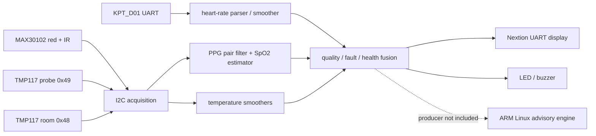

# 2026 AMD FPGA 自主选题设计报告

## 1. 选题与目标

作品面向学生航天舱健康监测演示：一块 PYNQ-Z2 并行接收心率、血氧、探头温度和室温，输出 Normal、Warning、Danger、SystemError 四态，并显示数值、趋势与故障原因。重点是传感器接入、PL 中的滤波和容错、可解释的有效性标志以及可复现的工程。该系统不承担临床诊断或生命保障功能，阈值是可配置的演示参数。

设计要处理的实际工程问题是：单个毛刺不应直接触发故障；通信超时或质量失效后不能继续使用陈旧数值；多器件故障需要和生理异常分开解释。与只显示四个数字的方案相比，本项目保留每路可用性、故障原因和系统级降级状态。

## 2. 功能结构与数据流

The top is `src/rtl/wyx_final_board_top.sv`. It instantiates the shared I2C acquisition, PPG filtering and SpO2 estimator, existing four-channel filter/fault/fusion modules, Nextion driver, and PS7 clock wrapper. The PS7 Block Design supplies FCLK0 at 25 MHz for acquisition, display and health-state logic, and FCLK1 at 100 MHz for the PPG filter and SpO2 estimator. Toggle-handshake mailboxes transfer paired PPG samples, overflow events, filter faults and estimator results between the two clock domains. The ARM Python monitor is an independent advisory consumer of JSONL records, not a verified direct reader of PL registers; a live PL-to-ARM producer is still needed.

### Fixed-point and interface contract

| Channel | Physical source | Interface | Internal numerical form |
| --- | --- | --- | --- |
| Heart rate | KPT_D01 | UART | bpm × 100 after parsed numeric frame |
| SpO2 | independent MAX30102 | I2C 100 kHz, paired red/IR | percent × 100 |
| Probe temperature | TMP117 `0x49` | shared I2C | signed °C × 128 |
| Room temperature | TMP117 `0x48` | shared I2C | signed °C × 128 |

MAX30102 red and IR values are a *pair from one device*, not two independently available sensors. Each data path carries freshness/validity. A failed channel is marked unavailable; old values are not forwarded as new samples. The original fusion criteria, weights and threshold configuration remain in the preserved RTL. Protected RTL hashes are listed in `data/core_sha256.json`. Personal resting-heart-rate observations were used only for debugging and were not encoded as new rules.

### PS/PL partition

PL handles time-critical acquisition, filters, range guards, sustained-fault confirmation, four-state fusion and display signaling. PS software can store history and produce explanatory messages when an external record producer supplies live measurements. The present source does not implement that producer, so PS-side behavior must not be reported as an end-to-end live measurement. This boundary keeps a reproducible RTL build while documenting the remaining system integration.

## 3. Build and timing evidence

The project was built with Vivado **2024.1**, which is outside the guide's recommended 2025.2/2026.1 versions. The repository therefore pins 2024.1 in its scripts and documents how to regenerate the XPR. Target part: `xc7z020clg400-1`. The full reports are under `build/reports/` and the bitstream hash is in `data/bitstream_sha256.txt`.

| Metric | Verified 25 MHz baseline | Current 25/100 MHz build |
| --- | ---: | ---: |
| LUT | 20,856 / 53,200 (39.20%) | 13,079 / 53,200 (24.58%) |
| Flip-flop | 6,428 / 106,400 (6.04%) | 9,091 / 106,400 (8.54%) |
| DSP48E1 | 55 / 220 (25.00%) | 64 / 220 (29.09%) |
| Block RAM tile | 0 / 140 | 0 / 140 |
| PS FCLK0 / FCLK1 | 25 MHz / disabled | 25 MHz / 100 MHz |
| Routed WNS / TNS | +8.082 ns / 0 ns at 25 MHz | +0.070 ns / 0 ns at 100 MHz |
| Routed WHS / THS | +0.025 ns / 0 ns | +0.037 ns / 0 ns |
| DRC errors / warnings | 0 / 127 | 0 / 110 |

The compute clock target increased fourfold, from 25 to 100 MHz. This does **not** imply fourfold sensor throughput: acquisition remains configured for about 100 PPG pairs per second and the estimator's update window is unchanged. LUT count fell by 7,777 while pipelining added 2,663 flip-flops and 9 DSP blocks. The WNS values use different clock constraints and should not be compared as a direct speedup. A 200 MHz static recheck of the old routed netlist failed with WNS -26.918 ns and 19,857 failing endpoints. Separate 200 MHz filter and divider routes passed, but the complete estimator did not meet 200 MHz synthesis timing; the full design was therefore built at 100 MHz.

The 100 MHz routed timing report has 37,633 endpoints, zero setup/hold failures, and 25 MHz and 100 MHz clock periods of 40 and 10 ns. The clock groups are declared asynchronous. `report_cdc` records one critical classification on the reset path (`reset_hold` logic before the compute reset synchronizer) and 60 mailbox data warnings; these remain visible in `build/reports/cdc.rpt`. The mailbox passed a 20-transfer simulation, but the CDC report is not a blanket proof of all reset sequences. External asynchronous I/O has no invented synchronous input/output delay constraint. Neither internal timing nor these tests verify electrical sensor/UART timing on a board.

## 4. Correctness and verification status

| Layer | Evidence | Status |
| --- | --- | --- |
| Release integrity | `sim/validate_release.py` checks required files, protected RTL hashes, two bitstream hashes, and report markers | Run with this package; result in `sim/validation_result.txt` |
| Project generation | Fresh project copy generated PS7 FCLK1 from `.bd`, then synthesized and routed | Passed with Vivado 2024.1 on 2026-11-04 |
| Current full synthesis, implementation, bit | `build/reports/*` and `board/wyxfinalproject.bit` | Passed with Vivado 2024.1; WNS +0.070 ns |
| RTL equivalence and CDC simulation | `sim/run_equivalence.ps1` and `sim/results/` | Filter: 260 samples; divider: 40 cases; estimator: one 400-sample waveform; mailbox: 20 transfers. All passed in XSim. |
| Earlier independent rebuild after directory change | `data/clean_rebuild_20261101.txt` | Historical 25 MHz baseline; does not validate the 100 MHz image |
| 25 MHz baseline, room channel and screen | `data/board_validation_20261102.md` | Passed for that image only |
| 25 MHz baseline, four-channel liveness | `data/board_validation_20261103.md`; 12 coherent snapshots with advancing counters | Passed for that image only |
| Current 100 MHz image, board liveness, accuracy and fault recovery | No board session yet | Pending |
| ARM live PL feed | JSONL contract exists, but producer is missing | Pending |

Earlier PYNQ-Z2 sessions demonstrated some sensor channels with the retained 25 MHz baseline image. Their captures have different firmware provenance from the current 100 MHz image and may contain personal health values, so they are not used to mark the new image as board-validated. The public baseline record excludes personal values. The new estimator equivalence simulation covers only one deterministic waveform; broader numerical equivalence, physical four-channel liveness, independent reference accuracy and fault recovery remain unverified for the 100 MHz image.

## 5. Reproduction procedure

1. Clone the repository to a short ASCII path on Windows and install Vivado 2024.1 with Zynq-7000 support.
2. Run `build/open_project.cmd`; inspect part, top and constraints in the generated XPR.
3. Close the GUI project, run `build/build_bitstream.cmd`, and inspect `build/reports/result.txt`, `timing.rpt`, `drc.rpt` and `utilization.rpt`.
4. Run `powershell -File sim/run_equivalence.ps1` and verify all four PASS markers in `sim/results/`. Run `python sim/validate_release.py` and `python build/check_paths.py .`.
5. Compare the generated bitstream hash with the recorded hash only when expecting an identical build; tool version or timestamps can change binary hash without proving a functional change.
6. Follow `board/README.md` to program a physically connected board, establish FCLK0=25 MHz and FCLK1=100 MHz, and record each channel's observed output and reference measurement. A board session is a separate acceptance gate.

## 6. Sources, collaboration and boundaries

The MAX30102 datasheet and the supplied sensor/Nextion packages informed the interfaces. Source and binary provenance are in `data/source_inventory.json` and `report/third_party_notices.md`. The earlier opaque `sensor_screen.bit` did not have a matching complete source; the current image is a new integration.

Selected AI collaboration and correction evidence is in `report/ai_collaboration.md`. The three reusable workflows selected for the contest are under `skill/`: layered sensor-link diagnosis, filter/fault evidence tracing, and shared-I2C scheduling. Their examples distinguish source/build review from physical measurements, and their templates can be applied to other sensor systems. No online website forwarding is included because the user deferred it.
